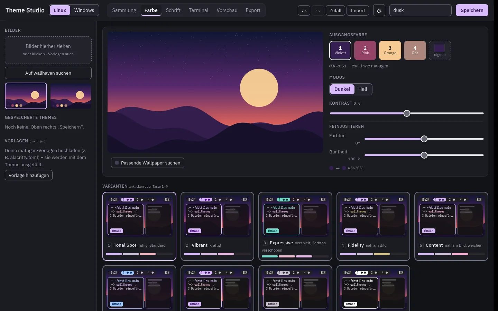
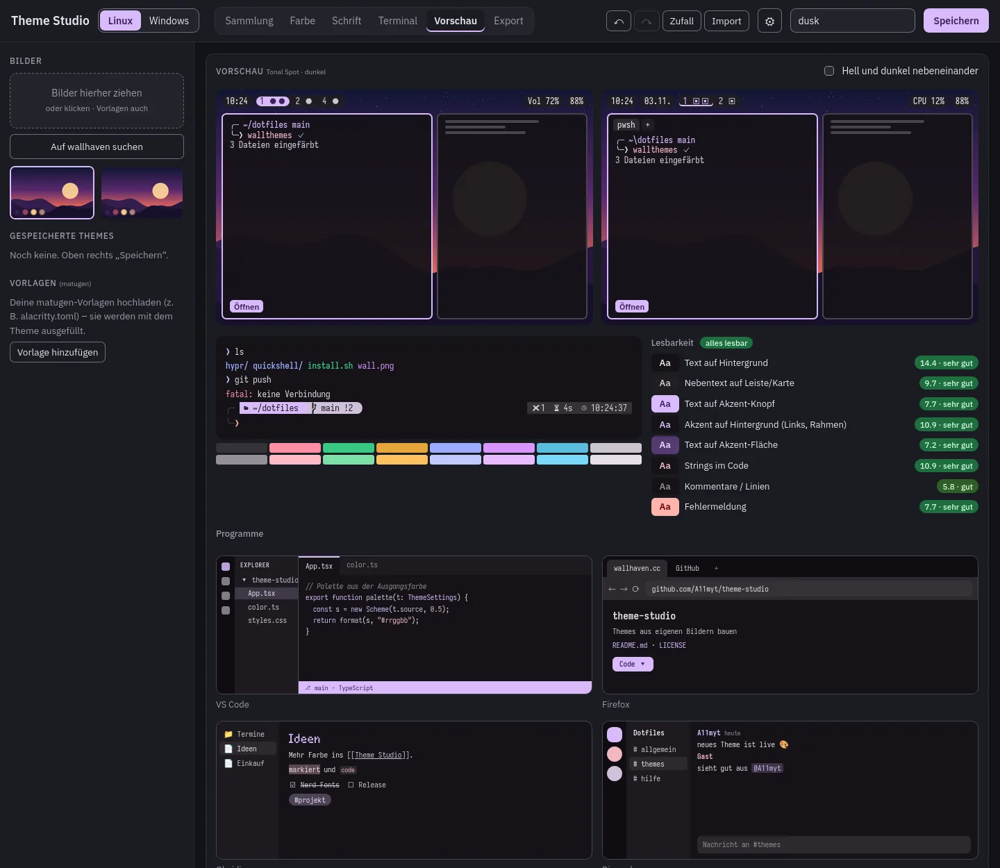
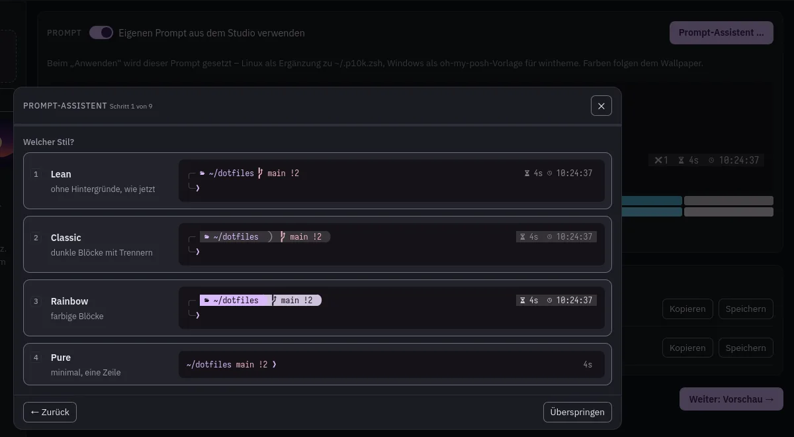
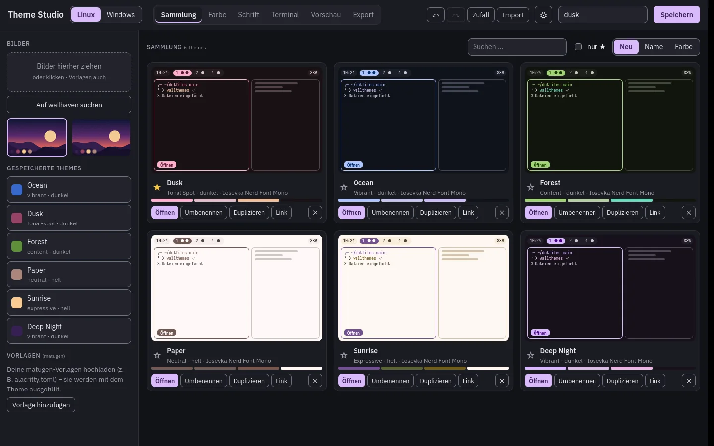

# Theme Studio

[English](README.md) · **Deutsch**



Desktop-Themes aus eigenen Wallpapern bauen. Alle neun Material-You-Varianten nebeneinander auf Mini-Desktops
vergleichen, feinjustieren und per Klick übernehmen – unter **Windows** (Akzentfarbe, Wallpaper, Windows
Terminal, VS Code, PowerShell-Prompt, komorebi) und unter **Linux**. Alles bleibt auf dem Rechner.

| Vorschau mit Apps | Prompt-Assistent | Sammlung |
|---|---|---|
|  |  |  |

## Holen

- **Windows**: Setup (aktualisiert sich selbst) oder `…-portable.exe` (einfach starten) unter
  [Releases](https://github.com/A11myt/theme-studio/releases)
- **Linux**: AppImage oder `.deb` unter Releases, oder selbst bauen (siehe unten)
- **Im Browser** (ohne Installation): https://a11myt.github.io/theme-studio/ – Gestalten und Exportieren gehen
  dort; Anwenden, Nerd Fonts und wallhaven-Suche brauchen die Desktop-App

Die Oberfläche gibt es auf **Deutsch und Englisch** (folgt der Systemsprache, umschaltbar unter ⚙ Einstellungen).
Beim ersten Start fragt die App, für welches System sie Themes anwenden soll (automatisch erkannt, später änderbar).

## Funktionen

- **Bilder**: Wallpaper reinziehen oder auf **wallhaven** suchen (nur jugendfrei, ≥ 1920×1080) – auch nach Farbe,
  passend zum Theme
- **Farben**: Ausgangsfarben des Bildes oder eigene; **9 Varianten** (tonal-spot, vibrant, expressive …) als
  Live-Mini-Desktops; Farbton und Buntheit verschieben oder einzelne Rollen überschreiben; Lesbarkeits-Ampel (WCAG)
- **Schriften**: Oberfläche, Mono und Akzent mit Größen; **Nerd Fonts** direkt von GitHub (nur 8 Dateien je Schrift)
- **Prompt-Assistent** (wie `p10k configure`): lean / classic / rainbow / pure, Zeilen, Rahmen, Trenner, Symbole,
  Prompt-Zeichen, rechte Seite, zusammenfalten. Erkennt deine Shells – PowerShell 5.1/7, Git Bash, bash, zsh,
  fish – und Frameworks (oh-my-zsh, powerlevel10k, oh-my-bash, oh-my-fish, starship) und bindet den Prompt über
  oh-my-posh ein (zsh: powerlevel10k oder oh-my-posh)
- **Anwenden unter Windows** – ohne Skripte, ohne Python: Wallpaper, Akzentfarbe und Hell/Dunkel, Windows-Terminal-
  Schema + Schrift, VS-Code-Farben + Schrift, PowerShell-Prompt, komorebi-Rahmen und -Leiste. Zeigt vorher, was
  gefunden wurde und was fehlt (mit Installationshinweis), protokolliert jeden Schritt, **Rückgängig** stellt den
  vorherigen Stand her, **Diagnose kopieren** für Hilfe (Benutzername ersetzt)
- **Anwenden unter Linux** über deine eigenen Skripte `wallthemes` + `fontgen`
- **Vorschauen** von VS Code, Firefox, Obsidian und Discord; 16 ANSI-Farben passend zum Theme
- **Exporte**: Theme-Datei (wieder einlesbar), VS-Code-Erweiterung (`.vsix`), Windows-Terminal-Schema,
  komorebi-Theme, oh-my-posh- und powerlevel10k-Prompt, base16-YAML, pywal `colors.json`, Xresources,
  CSS-Variablen und eigene Vorlagen (`{{colors.<rolle>.<variante>.<format>}}`, `{{fonts.*}}`, `{{mode}}`)
- **Sammlung** mit Favoriten, Suche und Sortierung; **Themes als Link teilen**; Rückgängig/Wiederholen; Zufall
- **Barrierefrei**: komplett per Tastatur, Fokus in Dialogen, beschriftete Bedienelemente, WCAG-Kontraste,
  Einzeltasten-Kürzel abschaltbar

## Entwickeln

```bash
pnpm install
pnpm dev          # Browser → http://localhost:5173 (leitet auch wallhaven weiter)
pnpm test         # vitest
pnpm app          # Desktop-App (Tauri 2, Entwicklungsmodus)
pnpm app:build    # → src-tauri/target/release/theme-studio
```

Linux braucht für die Desktop-App Rust (`rustup`) und `webkit2gtk-4.1 libappindicator-gtk3 librsvg`.
Das WebAssembly-Farbmodul liegt fertig in `src/wasm/`; neu bauen mit `pnpm build:wasm`
(braucht `wasm32-unknown-unknown` und `wasm-bindgen-cli 0.2.130`).

Aufbau: `src/useStudio.ts` (Zustand + Aktionen), `src/panes/` (eine Datei je Bereich), `src/components/`,
`src/lib/` (Farben, Exporte, Prompt, Shells, Links …), `src/lib/windows/` (Anwenden unter Windows),
`color-wasm/` (Ausgangsfarben als WebAssembly), `src-tauri/` (Desktop-App, Windows-Bausteine).

### Releases

`git tag v0.2.0 && git push --tags` baut Windows (Setup + portable exe) und Linux (AppImage, .deb), signiert die
Updates und veröffentlicht ein Release mit `latest.json`, das die installierte App beim Start prüft.

## Danksagung

- [material-colors](https://github.com/Aiving/material-colors) (MIT oder Apache-2.0) – Ausgangsfarben aus Bildern,
  als WebAssembly; liegt in `color-wasm/vendor/` mit einer Änderung (keine Zeitmessung unter WebAssembly)
- [Material Color Utilities](https://github.com/material-foundation/material-color-utilities) (Apache-2.0) – Paletten
- [Nerd Fonts](https://github.com/ryanoasis/nerd-fonts), [wallhaven](https://wallhaven.cc),
  [oh-my-posh](https://ohmyposh.dev), [komorebi](https://github.com/LGUG2Z/komorebi)

## Lizenz

MIT – siehe `LICENSE`. `color-wasm/vendor/material-colors` ist MIT oder Apache-2.0 (Lizenzdateien liegen bei).
