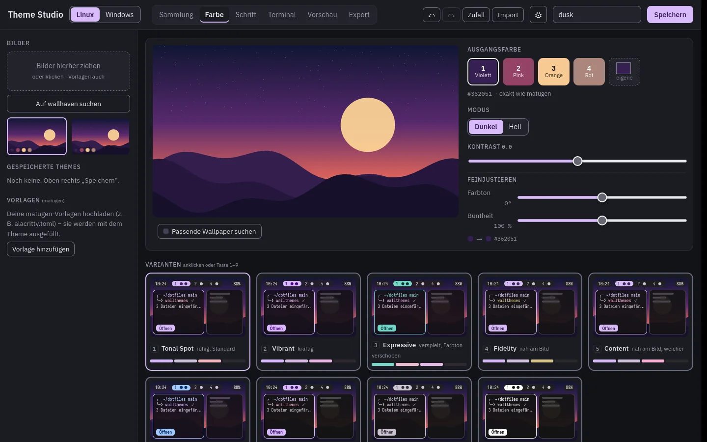
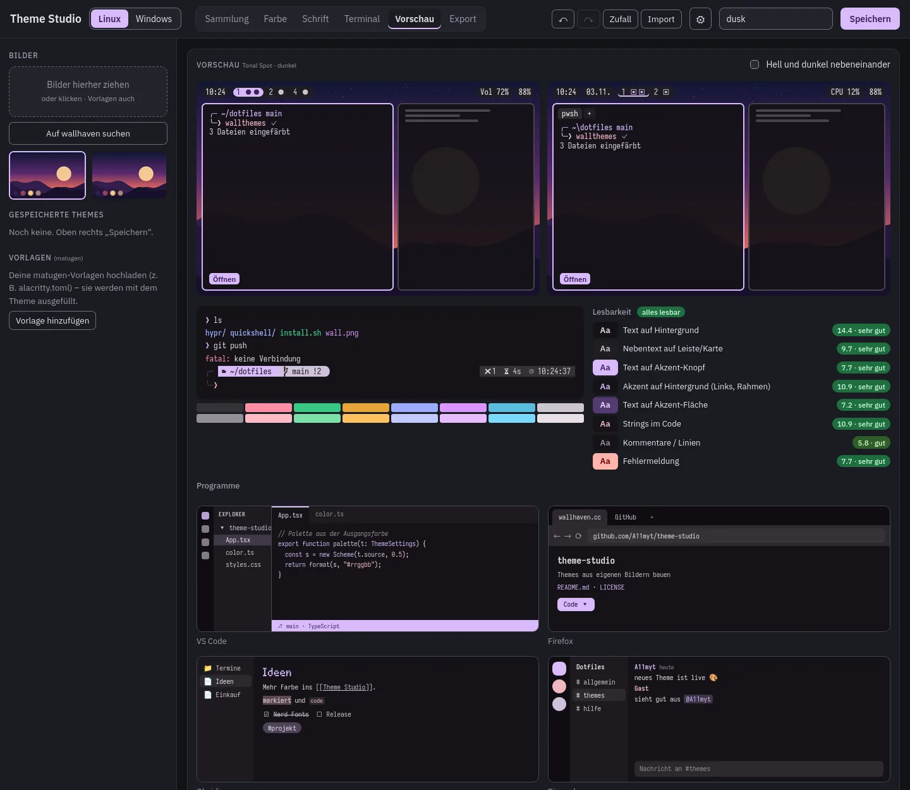
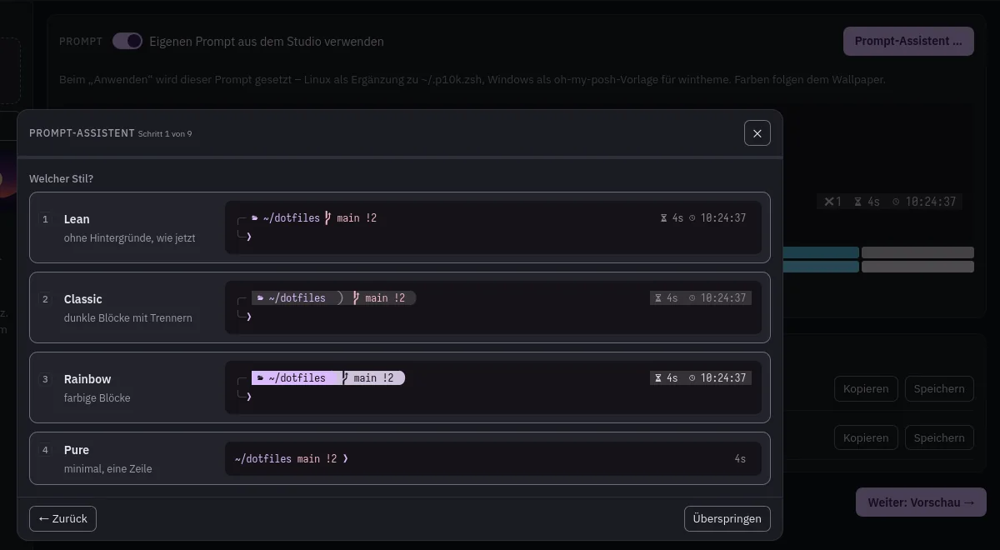
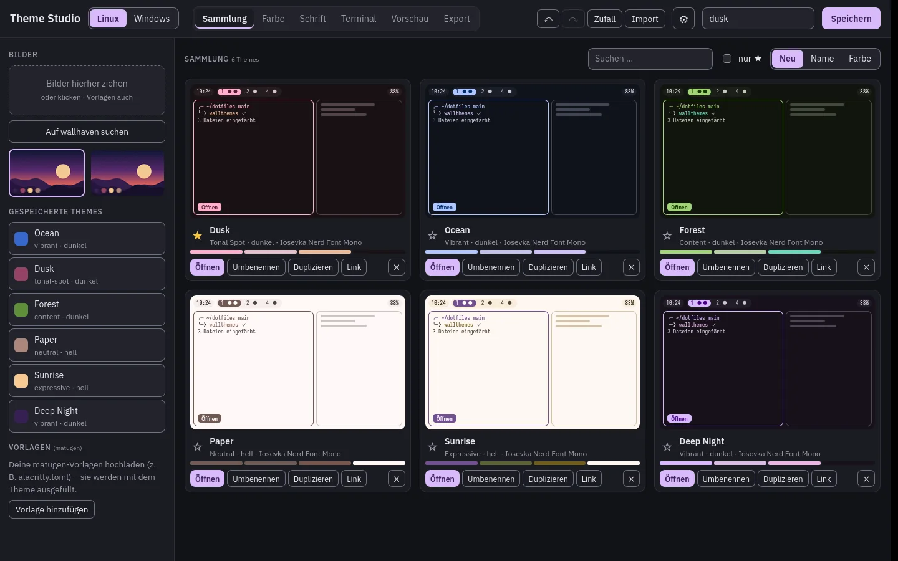

# Theme Studio

**English** · [Deutsch](README.de.md)



Build desktop themes from your own wallpapers. Compare all nine Material You variants side by side on mini
desktops, tweak them, and apply the result to **Linux** ([matugen](https://github.com/InioX/matugen)-based
setups) and **Windows** (Windows accent, Windows Terminal, VS Code, oh-my-posh, komorebi) – with one click.

The source colors are **exactly** what matugen picks, because Theme Studio runs matugen's own Rust color code
(`material-colors` 0.4.2) as WebAssembly. Everything stays on your machine.

| Preview with apps | Prompt wizard | Collection |
|---|---|---|
|  |  |  |

## Get it

- **In the browser** (no install): https://a11myt.github.io/theme-studio/ – applying themes, Nerd Font installs
  and wallhaven search need the desktop app
- **Windows**: installer (updates itself) or `…-portable.exe` (just run it) from
  [Releases](https://github.com/A11myt/theme-studio/releases)
- **Linux**: AppImage or `.deb` from Releases, or build it yourself (see below)

The interface is available in **English and German** (follows your system language; switch in ⚙ Settings).

## Features

- **Images**: drag & drop your wallpapers or search **wallhaven** (SFW only, ≥ 1920×1080) – also by color,
  to find wallpapers that match your theme
- **Source colors** identical to matugen, or pick your own; **9 variants** (tonal-spot, vibrant, expressive …)
  as live mini desktops for Linux (bubble bar) and Windows (komorebi bar + terminal)
- **Fine-tuning**: shift hue and chroma of the source color, or override single roles (click a palette swatch) –
  overrides are passed to matugen via `matugen json`, so your own templates stay in charge
- **Readability**: WCAG contrast of the key color pairs as a traffic light
- **Fonts** like [fontgen](https://github.com/A11myt/dotFiles): UI, mono and accent font with sizes;
  **Nerd Fonts** straight from GitHub (only 8 files per font: Mono + Propo × 4 styles)
- **Terminal & prompt wizard** (like `p10k configure`): lean / classic / rainbow / pure, lines, frame,
  separators, icons, prompt char, right side, transient prompt – outputs a powerlevel10k add-on (uses terminal
  color numbers, so it follows matugen) and an oh-my-posh template (recolored by wintheme)
- **Previews** of VS Code, Firefox, Obsidian and Discord; 16 ANSI colors harmonized to your theme
- **Apply** (desktop app): Linux via `wallthemes` + `fontgen`, Windows via `wintheme`
- **Exports**: theme file (re-importable), VS Code extension (`.vsix`), Windows Terminal scheme + font,
  komorebi theme, base16 YAML, pywal `colors.json`, Xresources, CSS variables, fontgen profile, and your own
  matugen/fontgen templates (`{{colors.<role>.<variant>.<format>}}`, `{{fonts.*}}`, `{{mode}}`)
- **Collection** with favorites, search and sorting; **share themes as links**; undo/redo; random theme
- **Accessible**: full keyboard support, focus handling in dialogs, labelled controls, WCAG contrasts,
  single-key shortcuts can be turned off

## Develop

```bash
pnpm install
pnpm dev          # browser → http://localhost:5173 (also proxies wallhaven)
pnpm test         # vitest – colors checked against matugen 4.2 reference values
pnpm app          # desktop app (Tauri 2, dev mode)
pnpm app:build    # → src-tauri/target/release/theme-studio
```

Linux needs Rust (`rustup`) and `webkit2gtk-4.1 libappindicator-gtk3 librsvg` for the desktop app.
The WebAssembly color module is prebuilt in `src/wasm/`; rebuild it with `pnpm build:wasm`
(needs `wasm32-unknown-unknown` and `wasm-bindgen-cli 0.2.130`).

Structure: `src/useStudio.ts` (state + actions), `src/panes/` (one file per view), `src/components/`,
`src/lib/` (color math, exporters, prompt, share links …), `color-wasm/` (matugen's color code), `src-tauri/`.

### Releases

`git tag v0.2.0 && git push --tags` builds Windows (installer + portable exe) and Linux (AppImage, .deb),
signs the updates and publishes a release with `latest.json`, which the installed app checks on start.

## Related

- [dotfiles](https://github.com/A11myt/dotFiles) – Hyprland + Quickshell setup with `wallthemes` and `fontgen`
- [dotfiles-windows](https://github.com/A11myt/dotfiles-windows) – `wintheme`, komorebi, whkd, Windows Terminal

## License

MIT – see `LICENSE`. `color-wasm/vendor/material-colors` is MIT or Apache-2.0.
